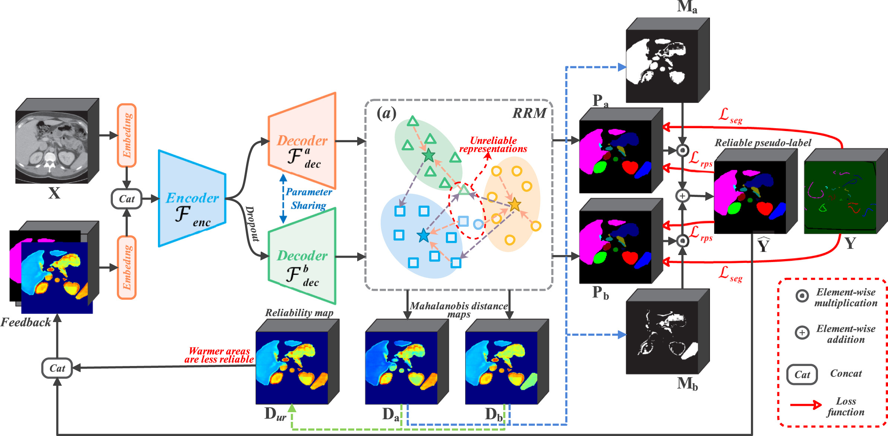

# Reliability-aware feedback learning for scribble-supervised 3D multi-organ segmentation
by [Xiaoxiang Han](https://linyer.ac.cn/), [Yiman Liu](https://linyer.ac.cn/authors/yiman-liu/), [Jiang Shang](https://scholar.google.com/citations?user=-jM7c_YAAAAJ), [Yunhao Bai](https://scholar.google.com/citations?user=5kJ22ZMAAAAJ), [Yan Wang](https://faculty.ecnu.edu.cn/_s15/wy2_en_19242/main.psp), and [Qi Zhang](https://scie.shu.edu.cn/Prof/zhangq.htm).

## Introduction
This repository contains the official implementation of *RAFLS*. The corresponding paper, titled "[Reliability-aware feedback learning for scribble-supervised 3D multi-organ segmentation](https://doi.org/10.1016/j.patcog.2026.115009)", has been published in *Pattern Recognition*. For any inquiries or issues, please contact [hanxx@shu.edu.cn](mailto:hanxx@shu.edu.cn).

## Highlights 
1. Model feature reliability via class-wise Mahalanobis distance in embedding space.
2. Introduce reliability-guided pseudo-label fusion using shared-decoder with dropout.
3. Develop reliability-aware feedback learning for adaptive focus on hard regions.
4. Achieve SOTA segmentation accuracy on BTCV/WORD with sparse scribble annotations.
5. Excel at segmenting small/complex organs under extremely sparse supervision.

## Pipeline
The pipeline of the proposed framework:

Architecture of the proposed reliability-aware feedback learning framework. The overall pipeline consists of an encoder and shared decoders with feedback connections. The framework integrates three key components: Reliability-aware Representation Modeling (RRM), Reliable Pseudo-Supervision, and Reliability-guided Feedback Learning. The framework takes input image X and sparse scribble annotations Y, generates embedding features, computes Mahalanobis distance maps to identify unreliable regions (warmer areas indicate lower reliability), produces reliable pseudo-labels through dual-prediction fusion, and feeds reliability-aware feedback signals back to the network to focus learning on hard regions.

## Citation
If you find these projects useful, please consider citing:

```bibtex
@article{han2027reliability,
  title={Reliability-aware feedback learning for scribble-supervised 3D multi-organ segmentation},
  author={Han, Xiaoxiang and Liu, Yiman and Shang, Jiang and Bai, Yunhao and Wang, Yan and Zhang, Qi},
  journal={Pattern Recognition},
  volume={183},
  pages={115009},
  year={2027},
  publisher={Elsevier},
  doi={https://doi.org/10.1016/j.patcog.2026.115009},
}
```
